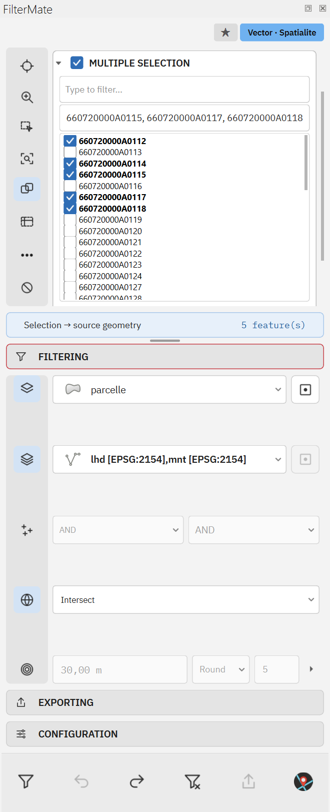
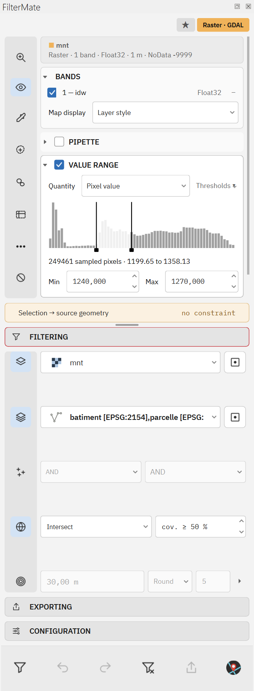
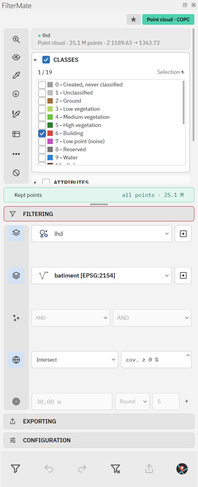

#  FilterMate

**🧭 Explore, 🔍 filter and 📦 export vector 🗺️, raster 🏔️ and LiDAR point cloud ☁️ layers in QGIS, from one panel.**

[](https://plugins.qgis.org/plugins/filter_mate)
[](https://plugins.qgis.org/plugins/filter_mate)
[](https://github.com/imagodata/filter_mate/actions/workflows/test.yml)
[](https://github.com/imagodata/filter_mate/actions/workflows/qgis-headless.yml)
[](https://imagodata.github.io/filter_mate)
[](LICENSE)

Pick a layer, select what matters on it, and FilterMate filters every other layer of the project by its relation to
that selection: buildings near main roads, parcels on steep slopes, LiDAR points beneath rooftops, a DTM
clipped around a church. The filters stay on the existing project layers, keep their styles, can be undone, saved as favorites, exported,
and replayed from Processing or a script.

<p align="center">
  
  &nbsp;
  
  &nbsp;
  
</p>
<p align="center"><em>The panel follows the current layer: several vector features ticked, a raster with its histogram, a LiDAR point cloud.</em></p>

🌐 [Website](https://imagodata.github.io/filter_mate) ·
📖 [User guide](https://imagodata.github.io/filter_mate/guide.html) ·
🇫🇷 [Guide utilisateur](https://imagodata.github.io/filter_mate/guide.fr.html) ·
💡 [Use cases](https://imagodata.github.io/filter_mate/stories.html) ·
📥 [Install from the QGIS repository](https://plugins.qgis.org/plugins/filter_mate)

---

## ⚙️ How it works

The panel has four sections, used top to bottom.

| Section | What you do there |
|---|---|
| 🧭 **EXPLORING** | Select on the current layer. Vector: one feature, several, or an expression. Raster: a band, a pixel value (picked on the map), a value range on a live histogram, classes of a paletted raster, a raster calculator expression. Point cloud: ASPRS / LiDAR HD classes, Z, intensity and return ranges, chained attribute conditions, height above a DTM. |
| 🔍 **FILTERING** | Choose the layers to filter and how they relate to the selection: geometric predicates (intersects, within, disjoint…), a buffer, AND / OR with existing filters, a minimum coverage for polygons. |
| 📦 **EXPORTING** | Write the filtered layers as they are: vector formats, GeoTIFF / COG for rasters, LAZ / LAS / COPC / GPKG / CSV for point clouds, or a GeoPackage with an embedded QGIS project. |
| 🔧 **CONFIGURATION** | Backends, theme, layer kinds, cache and other options, from the panel. |

**Nine combinations. One panel.** Every kind of layer can be the source or a target. Each cell links to a detailed use case:

| Source ↓ / Target → | 🗺️ Vector | 🏔️ Raster | ☁️ Point cloud |
|---|---|---|---|
| 🗺️ **Vector** (features) | [Buildings near main roads](https://imagodata.github.io/filter_mate/stories.html#s2) | [DTM around the church](https://imagodata.github.io/filter_mate/stories.html#s12) | [Point cloud around the church](https://imagodata.github.io/filter_mate/stories.html#s12) |
| 🏔️ **Raster** (value range, classes…) | [Parcels on steep slopes](https://imagodata.github.io/filter_mate/stories.html#s9) | [NDVI mask on an RGB orthophoto](https://imagodata.github.io/filter_mate/stories.html#s13) | [LiDAR points beneath rooftops](https://imagodata.github.io/filter_mate/stories.html#s14) |
| ☁️ **Point cloud** (classes, ranges…) | [Building heights measured by LiDAR](https://imagodata.github.io/filter_mate/stories.html#s10) | [DTM beneath ground points](https://imagodata.github.io/filter_mate/stories.html#s15) | [High vegetation near power lines](https://imagodata.github.io/filter_mate/stories.html#s16) |

Filtered layers keep their id, style and place in the layer tree. Unfilter, Undo / Redo and unloading the plugin put
the original source back, and project files are always saved with the original sources.

## ✨ Features

- ⚡ **Fast on large data.** Filters run as SQL on PostgreSQL / PostGIS, SpatiaLite and GeoPackage (spatial index used,
  no reload), with an OGR path for everything else. In the [documented Saint-Gaudens run](https://imagodata.github.io/filter_mate/stories.html#s1),
  12 layers from a 2.9 GB department-wide GeoPackage were filtered in under a second. Timings depend on the data, hardware and cache.
- 🌐 **Web services and remote files** (WFS, OGC API Features, ArcGIS, WMS / WMTS / XYZ, WCS, vector tiles, remote COPC / EPT): filtered and explored with bounded, cancellable reads, never on the main thread, and with an explicit refusal rather than a silently partial result.
- 🎯 **Pipettes on the map**: similar pixels, the clicked object or every similar object on a raster; a value condition on a point cloud attribute.
- ✏️ **Zone on the map**: draw a rectangle, polygon, freehand shape or circle; on a vector layer it selects the features it touches, on a raster it keeps the pixels inside it, on a point cloud it cuts the targets.
- 🎨 **Raster bands**: tick the bands that drive the pipette and the value range, and display one in grey or up to three as a colour composite (false colour included).
- ↩️ **Undo / Redo** of every filter, per layer, and a global history.
- ⭐ **Favorites**: save a filter with its layers and settings, replay it in a click, share it with a team through a git
  repository ([docs/favorites_sharing/USER_GUIDE.md](docs/favorites_sharing/USER_GUIDE.md)).
- 🤖 **Automation**: nine Processing algorithms and four ready-made models, `qgis_process`, a Python API for scripts and
  other plugins, an optional REST API and an MCP server for AI assistants ([docs/AUTOMATION.md](docs/AUTOMATION.md)).
- 🧩 **QGIS 3.22 to 4.x**, Qt5 and Qt6, 🌗 light and dark themes, 🌍 34 languages.

## 📥 Installation

In QGIS: **Plugins → Manage and Install Plugins**, search for **FilterMate**, then **Install Plugin**. The FilterMate
button appears in the plugin toolbar.

Manual install: download a zip from [GitHub Releases](https://github.com/imagodata/filter_mate/releases) and use
**Plugins → Manage and Install Plugins → Install from ZIP**.

### 📋 Requirements

| | |
|---|---|
| 🟢 QGIS | 3.22 or later, QGIS 4.x included. Point cloud layers need QGIS 3.26+. |
| 🐘 PostgreSQL / PostGIS (optional) | `psycopg2`, shipped with most QGIS installs; otherwise `pip install psycopg2-binary` in the QGIS Python. |
| ☁️ PDAL (optional) | PDAL 2.4+ (`pdal` command, shipped with QGIS on Windows) for the height above a DTM and direct COPC writing. Without it, point clouds are clipped by the QGIS exporter. |
| 🌐 REST API (optional) | `pip install -r requirements-api.txt` (FastAPI, Uvicorn, Pydantic). |

## 🤖 Automation in two lines

```python
from qgis.utils import plugins

api = plugins["filter_mate"].get_public_api()
api.cross_filter("mnt", ["parcelle", "lhd"], coverage_min=50,
                 raster_selection={"band": 1, "mode": "range", "minimum": 1200, "maximum": 1300})
```

The same operation is available as the `filtermate:cross_filter_from_raster` Processing algorithm, from
`qgis_process`, and as `POST /filters/cross` on the REST API. See [docs/AUTOMATION.md](docs/AUTOMATION.md).

## 📚 Documentation

| | |
|---|---|
| 📖 [User guide](https://imagodata.github.io/filter_mate/guide.html) · [Guide utilisateur](https://imagodata.github.io/filter_mate/guide.fr.html) | Step by step: first filter, exploring, predicates and buffers, rasters and point clouds, favorites, export, backends, configuration. |
| 💡 [Use cases](https://imagodata.github.io/filter_mate/stories.html) · [Cas d'usage](https://imagodata.github.io/filter_mate/stories.fr.html) | Sixteen business questions covering all nine combinations: twelve QGIS recordings and four illustrated recipes, in English and French. |
| 🤖 [docs/AUTOMATION.md](docs/AUTOMATION.md) | Processing algorithms and models, `qgis_process`, Python API, REST API. |
| ⭐ [docs/favorites_sharing/](docs/favorites_sharing/USER_GUIDE.md) | Sharing favorites through git repositories. |
| 🏗️ [docs/ARCHITECTURE.md](docs/ARCHITECTURE.md) · [CONTRIBUTING.md](CONTRIBUTING.md) | Source tree, code rules, tests and releases, for contributors. |
| 📝 [CHANGELOG.md](CHANGELOG.md) | Release notes. |

## 🛠️ Development

```bash
pip install -r requirements-test.txt
python -m pytest tests/ -o "addopts="     # unit tests, no QGIS needed (qgis.* is mocked)
```

The CI also loads the plugin in the official QGIS Docker images (3.22 → nightly) and drives the dock with its GUI
(`tests/qgis_headless/`). Start with [docs/ARCHITECTURE.md](docs/ARCHITECTURE.md) for a map of the source tree and
[CONTRIBUTING.md](CONTRIBUTING.md) for the code rules (Qt5 / Qt6 guards, translations, zip build, pull requests).

🐛 Bugs and 💬 ideas: [GitHub issues](https://github.com/imagodata/filter_mate/issues).

## 📄 License

GNU General Public License v3.0, see [LICENSE](LICENSE). Developed by [imagodata](https://github.com/imagodata) · simon.ducournau+filter_mate@gmail.com.
Map data in the screenshots: BD TOPO® and LiDAR HD © IGN, Licence Ouverte 2.0.
