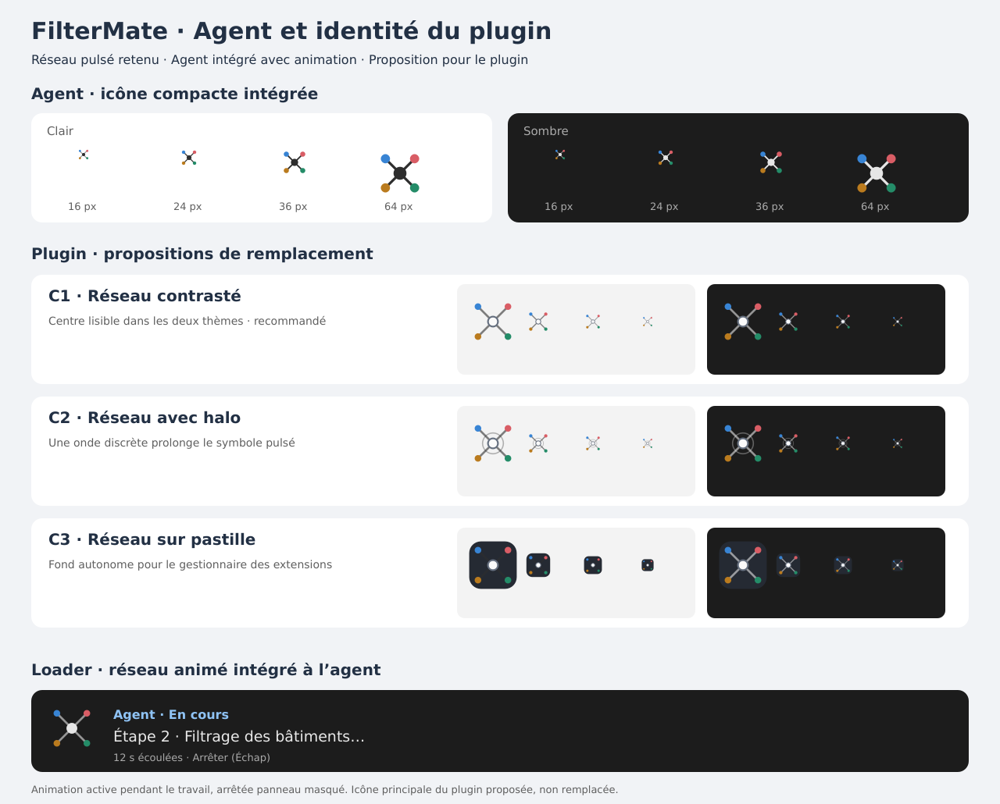
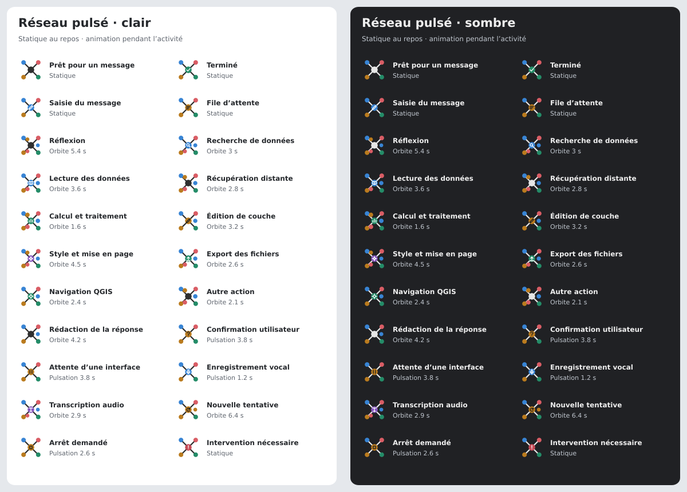

# Identité du réseau pulsé pour FilterMate et son agent

Le réseau pulsé est la direction retenue par l’utilisateur pour l’accueil et l’indicateur d’activité de l’agent. Le titre de l’onglet AGENT conserve son ancienne icône de conversation. Pour le plugin, la variante proposée renforce le contraste du centre et simplifie les détails aux tailles des barres d’outils.

## Agent intégré

- [Icône claire](agent-light.svg) et [icône sombre](agent-dark.svg), dessinées sur une grille de 24 unités.
- [Animation claire](agent-loader-light.svg) et [animation sombre](agent-loader-dark.svg).
- Quatre branches colorées, centre suivant le thème et points en orbite agrandis. Le loader occupe 32 pixels.
- Indicateur visible aussi au repos : réseau statique au démarrage, puis coche discrète après une réponse terminée.
- Animation limitée à 20 images par seconde, active pendant le travail ou la dictée, arrêtée lorsque le panneau est masqué. La saisie d’un brouillon et la file d’attente restent statiques.

Le rendu partagé de `ui/styles/mockup_design.py` distingue l’ancienne icône de titre `agent` du réseau `agent_network` utilisé dans l’accueil. Les icônes de titre sont conservées en [clair](agent-tab-light.svg) et [sombre](agent-tab-dark.svg). Le composant `ui/widgets/agent_activity.py` possède son propre moteur SVG ; les animations ne sont pas placées dans le cache global des icônes.

## Animation selon les actions

La famille actuelle comprend **22 états**, chacun décliné pour les thèmes clair et sombre :
[planche statique](agent-states-static.svg), [planche animée](agent-states-animated.svg).

Les SVG de repos prêts à utiliser sont [Prêt, clair](states/idle-light.svg), [Prêt, sombre](states/idle-dark.svg),
[Terminé, clair](states/complete-light.svg) et [Terminé, sombre](states/complete-dark.svg).
Le dessin garde les quatre nœuds colorés ; une petite marque centrale et le rythme distinguent les actions.
Les variations suivent les vrais noms d’outils : recherche, lecture, calcul, édition de couche, export, style,
navigation, rédaction, récupération distante. Côté utilisateur : saisie, messages en file, confirmation, voix et
transcription. Une saisie pendant un calcul ne remplace pas l’état du calcul. Une erreur ou un arrêt conserve un
état distinct. L’icône de titre de l’onglet reste l’ancienne bulle de conversation.

Les 44 SVG de `states/` et les deux planches proviennent du même générateur que le rendu du plugin :
`python3 scripts/render_agent_activity_variants.py` ; `--check` vérifie qu’ils sont à jour.

La vitesse et l’affichage suivent les événements de la conversation et des outils. Les changements de phase viennent des callbacks du contrôleur, sans interpréter les textes traduits. Envoyer plusieurs fragments de texte dans une même phase ne redémarre pas son animation.

| Activité | Affichage | Tour complet |
|---|---|---|
| Préparation de réponse | Trois points et pulsation lente | 5,4 s |
| Lecture par un outil | Deux points plus grands | 3,6 s |
| Autre action | Trois grands points et pulsation plus vive | 2,1 s |
| Appel d’un outil extérieur | Trois points et rythme intermédiaire | 2,8 s |
| Réponse reçue progressivement | Un point bleu, plus discret | 4,2 s |
| Attente d’interface | Centre ambre avec pause, pulsation calme | Pas d’orbite |
| Nouvelle tentative | Un point ambre, rotation lente | 6,4 s |
| Arrêt demandé | Centre ambre avec carré d’arrêt | Pas d’orbite |

[Comparer les animations](agent-activity-phases.svg) et [aperçu des états](agent-activity-phases.png). Une attente de confirmation retrouve ensuite sa phase précédente ; un arrêt ou un changement de conversation conserve son nouvel état. Les recettes utilisent le même indicateur lorsqu’elles exécutent leurs outils.

Les fichiers fournis comme références utilisent `animate` et `animateMotion`. QtSvg les charge comme images mais ne reconnaît pas leurs animations dans les environnements vérifiés. Les variantes utilisent `animateTransform`, pris en charge par Qt5 et Qt6. Cette adaptation conserve la pulsation et les orbites sans ajouter de navigateur embarqué. [Prise en charge SVG par Qt](https://doc.qt.io/qt-6/topics-vectorimageformats.html).
La pulsation précise ses deux composantes d’échelle : `0.7 0.7;1.15 1.15;0.7 0.7`. Avec une seule composante,
Qt 6 pouvait déclarer le document animé tout en gardant une image fixe. Les contrôles comparent désormais les
images effectivement affichées, y compris la pulsation lente de confirmation.

## Proposition pour le plugin

La variante C1 Réseau contrasté est recommandée : un centre clair avec contour gris, quatre nœuds colorés et des connexions plus épaisses. C2 ajoute un halo discret ; C3 présente le même réseau sur une pastille sombre. La planche compare leurs rendus à 16, 24, 32 et 64 pixels, sur fonds clair et sombre.

Les fichiers prêts à examiner sont :

- C1 statique : [thème clair](plugin-network-pulse-refined-light.svg), [thème sombre](plugin-network-pulse-refined-dark.svg).
- C1 animée : [thème clair](plugin-network-pulse-refined-animated-light.svg), [thème sombre](plugin-network-pulse-refined-animated-dark.svg).
- [Planche vectorielle](identity-proposals.svg) et [aperçu PNG](identity-proposals.png).

L’icône principale `icon.png` et sa copie `icons/icon.png` restent inchangées. Une adoption de C1 pourra produire les PNG de distribution depuis le SVG. La version animée convient aux composants qui possèdent un moteur d’animation ; une icône PNG du gestionnaire des extensions reste statique.

## Vérifications

Les rendus et le cycle de vie du composant ont été vérifiés dans QGIS 3.44.15 avec Qt 5.15.18 et QGIS 4.3.0 Master avec Qt 6.10.2. Les contrôles couvrent l’animation réelle des images, l’arrêt lorsque le parent est masqué, la reprise, les thèmes et les tailles de l’icône. Les tests automatisés vérifient aussi que deux indicateurs ne partagent pas leur moteur et que l’absence de QtSvg laisse le panneau utilisable.

Les 1 165 tests ciblés des contrôleurs et de l’interface passent après cette évolution. Résultats des rendus : [Qt5](validation-qt5.json), [Qt6](validation-qt6.json). Les références originales sont conservées dans [favicon-reference.svg](favicon-reference.svg) et [logo-reference.svg](logo-reference.svg).
